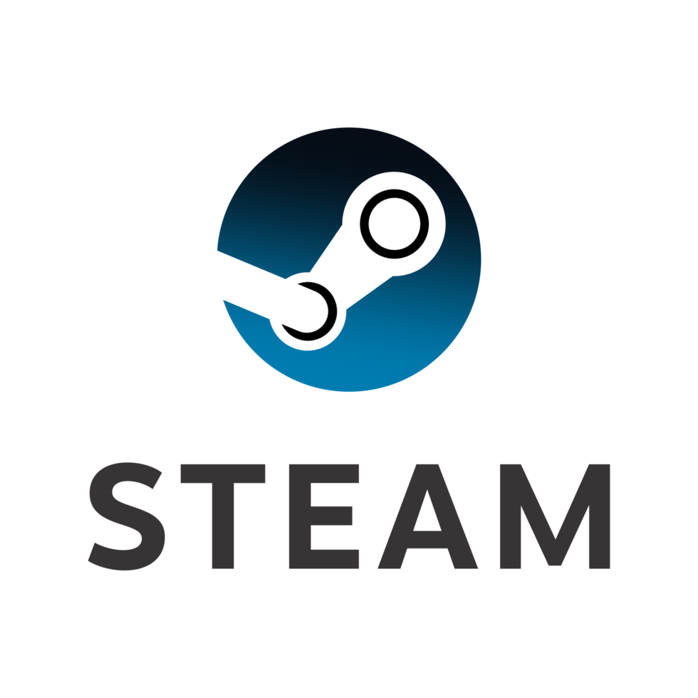
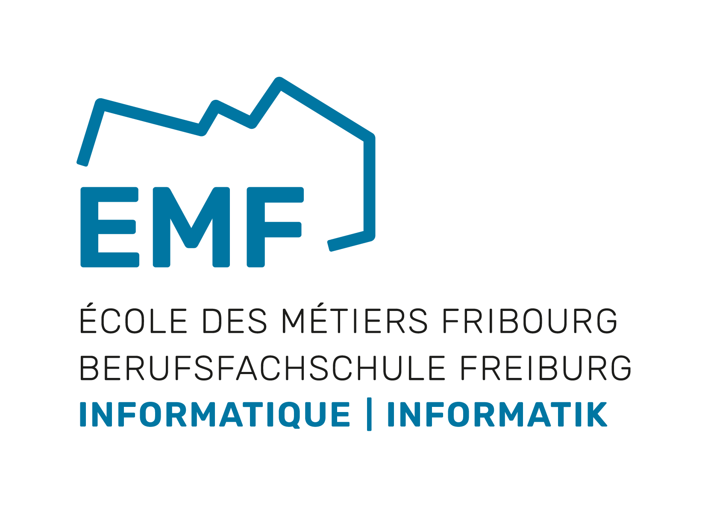

<h1>Module 323 - E1 - Programmer de manière fonctionnelle</h1>

**Durée :** 3h

# Introduction



**La société de jeux `Steam` vous mandate pour réaliser un tableau de bord.**

Elle vous mets à disposition toutes les données des jeux qu'elle mis en oeuvre en 2025 (dans `steamData`). Et comme à l'accoutumée, vous recevez et disposez de ces données directement dans un fichier du projet qui les préchargera [e1-data.js](/src/e1-data.js).

Ces données émanent d'une base MongoDB (ce qui explique la très agréable répétition de certains champs). Plus tard, une fois que vous aurez réalisé ces transformations demandées ci-dessous, de nouvelles APIs seront réalisées pour couvrir les besoins de ce nouveau tableau de bord. Pour le réaliser, vos requêtes fonctionnelles seront transmises à l'équipe en charge de ces APIs afin d'exécuter ces transformations directement lors des requêtes MongoDB afin que les données soient retournées directement comme souhaité.

En attendant, votre mission est de les aider avec la programmation fonctionnelle afin de finaliser ces transformations de données qui leur permettra de réaliser le tableau de bord dynamique souhaité qui s'affichera sur leur futur site interne de `Steam`. Ce tableau de bord sera très utile à la gestion de l'entreprise.

La personne en charge n'est pas à l'aise avec cette technologie et ne sait pas comment faire. Par contre elle sait exactement ce qu'elle souhaite obtenir et extraire comme information en exploitant les données qui vous sont fournies.

L'entreprise compte sur vous pour réaliser les requêtes fonctionnelles spécifiques ci-dessous de manière professionnelle.

>[!CAUTION]
>Il est clairement attendu de votre part que vous manipuliez ces données **de manière fonctionnelle**, en respect des enseignements reçus, afin de filtrer, réduire, ... ces données comme souhaité.
>
>⚠️ De manière générale : évitez les boucles `foreach()` ‼️

# Transformations à réaliser

- [Introduction](#introduction)
- [Transformations à réaliser](#transformations-à-réaliser)
  - [Rapport A01 - Le nombre de jeux payants et gratuits](#rapport-a01---le-nombre-de-jeux-payants-et-gratuits)
  - [Rapport A02 - La répartition des jeux par plateforme](#rapport-a02---la-répartition-des-jeux-par-plateforme)
  - [Rapport A03 - Les genres de jeu disponibles et le nombre de jeux correspondants](#rapport-a03---les-genres-de-jeu-disponibles-et-le-nombre-de-jeux-correspondants)
  - [Rapport A04 - La liste des jeux disponibles et leur genre, alphabétiquement triés](#rapport-a04---la-liste-des-jeux-disponibles-et-leur-genre-alphabétiquement-triés)
  - [Rapport A05 - Les jeux pas gratuits dont le prix est inférieur ou égal à 5 CHF, triés par prix d'abord puis par nom](#rapport-a05---les-jeux-pas-gratuits-dont-le-prix-est-inférieur-ou-égal-à-5-chf-triés-par-prix-dabord-puis-par-nom)
  - [Rapport A06 - Le prix moyen de tous les jeux (sans les gratuits), arrondi à deux décimales](#rapport-a06---le-prix-moyen-de-tous-les-jeux-sans-les-gratuits-arrondi-à-deux-décimales)
  - [Rapport A07 - Les meilleurs/pires jeux par rating, triés par rating puis par nom](#rapport-a07---les-meilleurspires-jeux-par-rating-triés-par-rating-puis-par-nom)
  - [Rapport A08 - Le TOP 10 des jeux sur lesquels les joueurs passent le plus de temps en moyenne](#rapport-a08---le-top-10-des-jeux-sur-lesquels-les-joueurs-passent-le-plus-de-temps-en-moyenne)
  - [Rapport A09 - Le chiffre d'affaires total réalisé en Suisse, à deux décimales avec séparateur de milliers](#rapport-a09---le-chiffre-daffaires-total-réalisé-en-suisse-à-deux-décimales-avec-séparateur-de-milliers)
  - [Rapport A10 - Le chiffre d'affaires total réalisé dans chacun des pays](#rapport-a10---le-chiffre-daffaires-total-réalisé-dans-chacun-des-pays)
  - [Rapport A11 - Le TOP 6 des jeux BINGO](#rapport-a11---le-top-6-des-jeux-bingo)
  - [Rapport A12 - Le CA par éditeur de jeu et pour chaque pays](#rapport-a12---le-ca-par-éditeur-de-jeu-et-pour-chaque-pays)

## Rapport A01 - Le nombre de jeux payants et gratuits

À partir des données déjà chargées dans `steamData`, vous devez obtenir ceci :

```json
{
   "total": 500,
   "gratuits": 32,
   "payants": 468
}
```

## Rapport A02 - La répartition des jeux par plateforme

À partir des données déjà chargées dans `steamData`, vous devez obtenir ceci :

```json
{
   "windows": 500,
   "mac": 224,
   "linux": 150
}
```

## Rapport A03 - Les genres de jeu disponibles et le nombre de jeux correspondants

À partir des données déjà chargées dans `steamData`, vous devez obtenir ceci :

```json
{
   "Adventure": 47,
   "Strategy": 52,
   "Action": 307,
   "MMO": 48,
   "RPG": 59,
   "Horror": 53,
   "Card Game": 54,
   "Puzzle": 53,
   "Management": 85,
   "Shooter": 48,
   "Survival": 57,
   "Racing": 51
}
```

## Rapport A04 - La liste des jeux disponibles et leur genre, alphabétiquement triés

Les genres du jeu sont rassemblés dans une seule chaîne de caractères avec ` / ` pour les séparer entre-eux.

À partir des données déjà chargées dans `steamData`, vous devez obtenir ceci :

```json
{
   "A Way Out": "Action / Card Game / Strategy",
   "Age of Empires II: Definitive Edition": "Action",
   "Age of Empires IV": "Action / Management",
   "American Truck Simulator": "Action",
   "Among Us": "Card Game / Horror / Management",
   "Ancient Circuit: Ascension": "Action / Puzzle",
   "Ancient Circuit: Definitive Edition": "Action / Strategy",
   "Ancient Citadel II": "Action / Management",
   "Ancient Citadel: Ascension": "Action",
   "Ancient Depths III": "Action / Management",
   "Ancient Horizon: Reborn": "Action / Horror",
   "Ancient Legacy: Definitive Edition": "Card Game / Racing / Survival",
   "Ancient Odyssey II": "Action / Adventure / Horror",
   "Ancient Outpost: Definitive Edition": "Action / Racing",
   "Ancient Protocol: Definitive Edition": "Action",
   "Ancient Signal: Origins": "Action / Shooter",
   "Ancient Tactics": "Management / Puzzle",
   "Ancient Tactics: Origins": "Action / Shooter",
   "Ancient Tactics: Reborn": "Action / Card Game",
   "Ancient Voyage: Definitive Edition": "Horror",
   "Ancient Voyage: Reborn": "Adventure",
   "Ancient Workshop II": "Adventure",
   "Ancient Workshop: Definitive Edition": "Action",
   "Apex Legends": "Action",
   "Arcane Arena III": "Horror / RPG",
   "Arcane Circuit II": "Card Game",
   "Arcane Colony II": "Action / Strategy",
   "Arcane Depths: Reborn": "Action",
   "Arcane Frontier III": "Action / Shooter",
   "Arcane Frontier: Definitive Edition": "Action / Adventure / Racing",
   "Arcane Horizon: Origins": "Action / MMO / Survival",
   "Arcane Legacy": "Action / Strategy",
   "Arcane Odyssey: Definitive Edition": "MMO / RPG",
   "Arcane Realms III": "Adventure / Horror / Survival",
   "Arcane Realms: Reborn": "Action / Horror",
   "Arcane Station: Definitive Edition": "Action",
   "Arcane Voyage II": "Management / RPG",
   "ARK: Survival Evolved": "Action / Shooter",
   "Assetto Corsa": "Action / Racing",
   "Baldur's Gate 3": "Action / Horror / Shooter",
   "BeamNG.drive": "Action / Card Game",
   "Broken Chronicles: Definitive Edition": "Action / Card Game",
   "Broken Empire: Ascension": "Management",
   "Broken Factory II": "Action / Management / Strategy",
   "Broken Factory: Definitive Edition": "Adventure",
   "Broken Horizon: Beyond": "Survival",
   "Broken Sanctuary: Beyond": "Action",
   "Broken Valley": "Action / Puzzle / RPG",
   "Broken Valley: Ascension": "Action",
   "Broken Voyage: Ascension": "Action",
   "Broken Voyage: Definitive Edition": "Action",
   "Burning Chronicles II": "Action",
   "Burning Dungeon": "Action / Adventure / Management",
   "Burning Empire: Beyond": "MMO / RPG",
   "Burning Expedition II": "Action / Management / Strategy",
   "Burning Expedition III": "Survival",
   "Burning Factory": "Horror / Management / Survival",
   "Burning Labyrinth: Beyond": "Puzzle / RPG",
   "Burning Legends: Beyond": "Management / RPG / Strategy",
   "Burning Realms: Reborn": "Action",
   "Burning Sanctuary II": "Management / Puzzle",
   "Burning Station: Beyond": "Adventure",
   "Burning Valley II": "Adventure / Strategy",
   "Burning Valley: Ascension": "Action / Card Game / RPG",
   "Celeste": "Action / Management",
   "Cities: Skylines": "Management / Survival",
   "Cities: Skylines II": "Action / RPG / Survival",
   "Civilization VI": "Action",
   "Clockwork Archive III": "MMO / Shooter / Strategy",
   "Clockwork Arena: Beyond": "Action",
   "Clockwork Horizon": "Action / Shooter",
   "Clockwork Kingdom II": "Shooter",
   "Clockwork Protocol: Origins": "Action / Card Game / Racing",
   "Clockwork Realms: Beyond": "Puzzle / Shooter / Strategy",
   "Clockwork Requiem: Definitive Edition": "Action",
   "Clockwork Signal": "RPG",
   "Clockwork Signal III": "Action / Racing",
   "Company of Heroes 2": "Action / Management / Strategy",
   "Counter-Strike 2": "Adventure / Strategy",
   "Crimson Archive II": "Action / Card Game / Survival",
   "Crimson Arena: Origins": "Action / MMO",
   "Crimson Dungeon: Origins": "Action / Shooter",
   "Crimson Horizon II": "Action / Management",
   "Crimson Horizon III": "MMO / RPG",
   "Crimson Odyssey: Beyond": "Strategy",
   "Crimson Odyssey: Origins": "Action / Puzzle",
   "Crimson Protocol II": "Action / Adventure",
   "Crimson Rebellion: Definitive Edition": "Action / Management",
   "Crimson Sanctuary: Origins": "Management / Racing",
   "Crimson Signal II": "Puzzle / Shooter / Survival",
   "Crimson Voyage": "Action",
   "Crimson Workshop II": "Horror",
   "Crusader Kings III": "Action",
   "Cuphead": "Racing / Shooter",
   "Cursed Archive III": "Action",
   "Cursed Circuit": "Action / Racing",
   "Cursed Expedition: Ascension": "Action / Racing",
   "Cursed Expedition: Definitive Edition": "Action / MMO",
   "Cursed Factory II": "Card Game / Horror / Management",
   "Cursed Labyrinth: Beyond": "Adventure / Horror / RPG",
   "Cursed Legends III": "Management / Shooter / Survival",
   "Cursed Requiem II": "Shooter / Strategy",
   "Cursed Signal: Origins": "Management",
   "Cyberpunk 2077": "Action",
   "Dark Archive: Beyond": "Action",
   "Dark Chronicles: Definitive Edition": "Action / Puzzle / RPG",
   "Dark Circuit: Definitive Edition": "Card Game / Racing",
   "Dark Citadel": "MMO / Puzzle / RPG",
   "Dark Depths: Origins": "Management / Shooter",
   "Dark Dungeon II": "Card Game / Shooter",
   "Dark Empire": "Action / Shooter",
   "Dark Labyrinth: Beyond": "Action / Strategy",
   "Dark Legacy III": "Management",
   "Dark Odyssey III": "Action / Card Game / Horror",
   "Dark Odyssey: Origins": "Action",
   "Dark Realms: Reborn": "Action",
   "Dark Rebellion": "MMO / Survival",
   "Dark Rebellion: Reborn": "Action / Management",
   "Dark Requiem III": "Horror / Management / Shooter",
   "Dark Souls III": "Action / Puzzle / Racing",
   "Dark Valley II": "Action",
   "Dark Valley III": "Action / Adventure / Racing",
   "Dead Cells": "Racing / Survival",
   "Deep Rock Galactic": "Management / Puzzle",
   "Destiny 2": "Action",
   "Devil May Cry 5": "Card Game",
   "Diablo IV": "Action",
   "Divinity: Original Sin 2": "RPG",
   "DOOM Eternal": "Action / Management / Survival",
   "Dota 2": "Action",
   "EA SPORTS FC 24": "Action",
   "Elden Ring": "Survival",
   "Electric Dungeon II": "Action",
   "Electric Empire: Origins": "Action",
   "Electric Factory: Definitive Edition": "Action / RPG",
   "Electric Factory: Reborn": "Management / Racing",
   "Electric Frontier: Reborn": "Action / Adventure",
   "Electric Labyrinth II": "Adventure",
   "Electric Odyssey III": "Action / Card Game / Management",
   "Electric Protocol: Beyond": "Action",
   "Electric Requiem": "Action",
   "Electric Sanctuary II": "Adventure",
   "Electric Sanctuary: Ascension": "Action / Strategy",
   "Electric Station III": "Action",
   "Electric Voyage: Origins": "Puzzle / Racing / Strategy",
   "Emerald Archive II": "Horror / Racing / Survival",
   "Emerald Chronicles II": "Action / Horror",
   "Emerald Factory II": "Action / Card Game / Shooter",
   "Emerald Labyrinth: Reborn": "Action / Shooter",
   "Emerald Odyssey": "Action",
   "Emerald Outpost II": "Card Game / Shooter",
   "Emerald Realms: Beyond": "Management",
   "Emerald Rebellion II": "Action",
   "Emerald Rebellion: Definitive Edition": "Action / Puzzle / Survival",
   "Emerald Tactics": "Racing / Survival",
   "Emerald Workshop: Origins": "Horror / Management",
   "Endless Archive": "Action",
   "Endless Arena: Beyond": "Action / Adventure / RPG",
   "Endless Depths II": "Action",
   "Endless Expedition II": "Action / Management",
   "Endless Factory": "Shooter",
   "Endless Horizon: Ascension": "Action / Horror",
   "Endless Odyssey II": "Action / Racing",
   "Endless Realms: Origins": "Action",
   "Endless Requiem: Beyond": "Action / Card Game / Management",
   "Endless Requiem: Origins": "Horror",
   "Endless Signal: Beyond": "MMO / Puzzle / Shooter",
   "Endless Signal: Definitive Edition": "MMO / Management / RPG",
   "Endless Workshop: Reborn": "Action",
   "Euro Truck Simulator 2": "Action",
   "Europa Universalis IV": "Action",
   "F1 23": "Action",
   "Factorio": "Racing / Strategy",
   "Fallout 4": "Action",
   "Fallout: New Vegas": "Survival",
   "Farming Simulator 22": "Action",
   "FINAL FANTASY VII REMAKE INTERGRADE": "Action",
   "FINAL FANTASY XIV Online": "Action",
   "Football Manager 2024": "Action / Card Game",
   "Forgotten Archive II": "MMO / Management",
   "Forgotten Archive III": "Survival",
   "Forgotten Empire: Beyond": "Action / Horror / Survival",
   "Forgotten Empire: Origins": "Racing",
   "Forgotten Expedition: Beyond": "Action / Adventure / MMO",
   "Forgotten Frontier: Definitive Edition": "Action",
   "Forgotten Kingdom: Reborn": "Action / Horror",
   "Forgotten Legends: Beyond": "Puzzle / RPG",
   "Forgotten Outpost: Beyond": "Action",
   "Forgotten Signal": "Action / MMO / Puzzle",
   "Forgotten Tactics": "Action / Shooter",
   "Forgotten Voyage II": "Action",
   "Forgotten Voyage: Definitive Edition": "Action / Puzzle",
   "Forgotten Workshop: Ascension": "Shooter",
   "Forza Horizon 5": "Action / Strategy / Survival",
   "Frozen Arena II": "Action / Management / RPG",
   "Frozen Chronicles: Ascension": "Management / Puzzle",
   "Frozen Citadel: Ascension": "Action / Puzzle",
   "Frozen Colony II": "Adventure / Management",
   "Frozen Colony: Ascension": "Action / Survival",
   "Frozen Empire": "Action / Management / Puzzle",
   "Frozen Empire: Definitive Edition": "Action",
   "Frozen Horizon III": "Action / Management",
   "Frozen Labyrinth: Ascension": "Action / Strategy / Survival",
   "Frozen Outpost: Reborn": "Action / Management",
   "Frozen Requiem": "Management / Racing / Shooter",
   "Frozen Station: Beyond": "Action",
   "Frozen Station: Reborn": "Action / Horror / Shooter",
   "Frozen Tactics: Ascension": "Management",
   "Golden Archive": "Shooter",
   "Golden Citadel: Beyond": "Horror",
   "Golden Colony: Definitive Edition": "Action",
   "Golden Depths: Ascension": "Action",
   "Golden Dungeon: Ascension": "Card Game / Survival",
   "Golden Empire: Reborn": "Survival",
   "Golden Factory": "Action / Strategy",
   "Golden Frontier: Definitive Edition": "RPG",
   "Golden Horizon: Beyond": "Action / Survival",
   "Golden Legacy: Definitive Edition": "Card Game / MMO / Shooter",
   "Golden Legacy: Origins": "Action / Survival",
   "Golden Odyssey: Definitive Edition": "Action",
   "Golden Realms: Definitive Edition": "Adventure / MMO / Management",
   "Golden Requiem II": "MMO",
   "Grand Theft Auto V": "Adventure",
   "Grim Dawn": "Action / RPG / Racing",
   "Hades": "Action / Horror",
   "Hades II": "Action / Survival",
   "Half-Life 2": "Action",
   "Hearts of Iron IV": "MMO",
   "Hidden Citadel: Reborn": "Adventure",
   "Hidden Dungeon: Definitive Edition": "Horror / RPG / Strategy",
   "Hidden Expedition: Beyond": "Horror",
   "Hidden Factory III": "Action",
   "Hidden Kingdom: Reborn": "Action / Horror / Strategy",
   "Hidden Protocol: Origins": "Action",
   "Hidden Realms: Origins": "Card Game / Shooter / Strategy",
   "Hidden Requiem": "Action / MMO",
   "Hidden Workshop: Definitive Edition": "RPG",
   "Hollow Knight": "Horror / Survival",
   "Iron Archive: Ascension": "Survival",
   "Iron Archive: Beyond": "Action / Card Game / Puzzle",
   "Iron Citadel: Reborn": "Action",
   "Iron Colony: Ascension": "Racing / Shooter / Survival",
   "Iron Depths II": "Action",
   "Iron Depths: Reborn": "Action / Racing",
   "Iron Empire": "Action / MMO / Strategy",
   "Iron Empire: Origins": "Action / Adventure",
   "Iron Legacy: Definitive Edition": "Action / Puzzle / Strategy",
   "Iron Legacy: Reborn": "Racing",
   "Iron Outpost: Ascension": "Horror / Management",
   "Iron Outpost: Definitive Edition": "Action",
   "Iron Protocol: Reborn": "Horror",
   "Iron Realms: Definitive Edition": "Horror",
   "Iron Valley: Ascension": "Action / Horror / Survival",
   "Iron Voyage II": "Management / RPG",
   "Iron Workshop": "Racing",
   "Iron Workshop: Beyond": "Action / Shooter",
   "It Takes Two": "Action / Card Game / MMO",
   "Kerbal Space Program": "Management / Survival",
   "Last Chronicles: Origins": "Action",
   "Last Citadel III": "Action / RPG / Strategy",
   "Last Empire III": "Puzzle / RPG",
   "Last Empire: Reborn": "Action / Puzzle / Survival",
   "Last Expedition II": "RPG",
   "Last Expedition: Beyond": "Horror",
   "Last Legacy: Ascension": "Management / Strategy",
   "Last Legacy: Definitive Edition": "Action",
   "Last Outpost: Reborn": "Action",
   "Last Protocol": "Adventure",
   "Last Rebellion: Beyond": "Action / Puzzle",
   "Last Requiem III": "Action / RPG",
   "Last Station: Ascension": "Action",
   "Last Station: Definitive Edition": "Adventure / Strategy",
   "Left 4 Dead 2": "Card Game / Puzzle / RPG",
   "Lethal Company": "Management / RPG / Survival",
   "Like a Dragon: Infinite Wealth": "Action / Survival",
   "Lost Archive: Origins": "Action",
   "Lost Circuit: Origins": "Action / Card Game / Survival",
   "Lost Colony": "Strategy",
   "Lost Depths: Ascension": "Puzzle",
   "Lost Depths: Definitive Edition": "Action / Survival",
   "Lost Factory II": "Strategy",
   "Lost Kingdom": "Action",
   "Lost Kingdom: Ascension": "RPG",
   "Lost Labyrinth: Definitive Edition": "MMO / Racing",
   "Lost Legacy: Ascension": "Card Game / Horror / Management",
   "Lost Legacy: Origins": "Action / Management",
   "Lost Rebellion: Origins": "Action",
   "Lost Sanctuary": "Action",
   "Lost Sanctuary: Definitive Edition": "Puzzle / Strategy",
   "Lost Tactics: Reborn": "Action / Adventure / Card Game",
   "Lunar Archive: Reborn": "Action / Racing / Shooter",
   "Lunar Colony II": "Action / Racing",
   "Lunar Frontier: Definitive Edition": "Action",
   "Lunar Kingdom: Ascension": "Action",
   "Lunar Requiem: Definitive Edition": "Action / MMO",
   "Minecraft Dungeons": "Action / Horror",
   "Monster Hunter Rise": "Action",
   "Monster Hunter: World": "Action / Horror",
   "Mortal Kombat 1": "Action / RPG",
   "Mount & Blade II: Bannerlord": "Racing",
   "Mystic Archive: Ascension": "Action / Racing / Survival",
   "Mystic Citadel: Reborn": "Action / Management / Puzzle",
   "Mystic Colony: Beyond": "Action",
   "Mystic Dungeon II": "Action / Management",
   "Mystic Horizon III": "Action",
   "Mystic Horizon: Ascension": "Action",
   "Mystic Horizon: Origins": "Action / Management",
   "Mystic Labyrinth: Ascension": "Action / RPG",
   "Mystic Odyssey: Reborn": "Action / Strategy",
   "Mystic Signal: Definitive Edition": "Action / Racing",
   "Mystic Tactics": "Action / MMO",
   "Mystic Tactics: Beyond": "Action / RPG",
   "Mystic Workshop III": "Puzzle",
   "Neon Archive": "Action",
   "Neon Arena III": "Action / Card Game / Strategy",
   "Neon Colony II": "Action / Card Game / RPG",
   "Neon Depths: Ascension": "Action / Management / Strategy",
   "Neon Dungeon": "MMO / Management / Survival",
   "Neon Frontier": "Action",
   "Neon Legacy: Ascension": "Action / Management",
   "Neon Odyssey": "Management",
   "Neon Rebellion: Reborn": "Action / Racing",
   "Neon Requiem: Origins": "Horror",
   "Neon Signal": "Horror / MMO",
   "Neon Voyage": "Adventure / Management",
   "Neon Voyage: Origins": "Action / Adventure",
   "NieR:Automata": "Action",
   "No Man's Sky": "Action / Adventure",
   "Obsidian Archive: Definitive Edition": "Action",
   "Obsidian Colony II": "MMO / Puzzle",
   "Obsidian Depths: Origins": "MMO",
   "Obsidian Dungeon III": "Action / Adventure",
   "Obsidian Factory": "RPG / Strategy",
   "Obsidian Horizon": "Action / RPG",
   "Obsidian Labyrinth: Reborn": "Action / RPG",
   "Obsidian Legends: Reborn": "Action / Management",
   "Obsidian Protocol II": "Action / Card Game / Shooter",
   "Obsidian Protocol: Beyond": "Survival",
   "Obsidian Protocol: Reborn": "Racing",
   "Obsidian Requiem": "Adventure / Racing / Survival",
   "Obsidian Signal: Reborn": "Puzzle / Racing",
   "Obsidian Station: Origins": "MMO",
   "Obsidian Tactics: Reborn": "Action",
   "Ori and the Will of the Wisps": "Action",
   "Overcooked! 2": "Card Game / Strategy",
   "Path of Exile": "Shooter",
   "PAYDAY 2": "Card Game / Management / Survival",
   "Persona 4 Golden": "Action / Horror",
   "Persona 5 Royal": "Action / MMO / Racing",
   "Phasmophobia": "Action / Card Game / MMO",
   "Planet Coaster": "MMO",
   "Planet Zoo": "Horror / MMO / Survival",
   "Portal 2": "Action / Horror / RPG",
   "PUBG: BATTLEGROUNDS": "Card Game / MMO",
   "Quantum Arena: Definitive Edition": "Card Game / Horror / Shooter",
   "Quantum Citadel": "Horror / Strategy",
   "Quantum Factory: Origins": "Strategy",
   "Quantum Frontier: Reborn": "Action / Survival",
   "Quantum Horizon: Beyond": "Action / RPG / Survival",
   "Quantum Kingdom III": "Card Game / RPG",
   "Quantum Rebellion: Reborn": "Action",
   "Quantum Requiem: Beyond": "Action",
   "Quantum Voyage: Reborn": "Racing",
   "Radiant Arena: Definitive Edition": "Action / Survival",
   "Radiant Chronicles: Definitive Edition": "Action / RPG",
   "Radiant Circuit: Ascension": "Adventure / RPG / Racing",
   "Radiant Colony": "Management",
   "Radiant Depths: Definitive Edition": "Action / RPG",
   "Radiant Depths: Reborn": "Action / Management",
   "Radiant Expedition: Ascension": "Action / Adventure / Racing",
   "Radiant Expedition: Beyond": "Card Game",
   "Radiant Labyrinth: Reborn": "Action",
   "Radiant Legends: Ascension": "Action / MMO / Puzzle",
   "Radiant Outpost III": "Management",
   "Radiant Outpost: Reborn": "Action",
   "Radiant Requiem": "Adventure",
   "Radiant Signal: Definitive Edition": "Management / Puzzle",
   "Red Dead Redemption 2": "Action",
   "Resident Evil 4": "Management / Strategy",
   "Resident Evil Village": "Action / Adventure / Strategy",
   "RimWorld": "Puzzle",
   "Risk of Rain 2": "Action / Puzzle",
   "Rocket League": "Action",
   "Rogue Chronicles II": "RPG",
   "Rogue Circuit II": "Action",
   "Rogue Circuit: Definitive Edition": "Action / Survival",
   "Rogue Citadel": "Adventure",
   "Rogue Depths: Beyond": "Adventure / Card Game",
   "Rogue Dungeon: Ascension": "Action",
   "Rogue Empire": "Action / Racing",
   "Rogue Empire III": "Action / Management / Strategy",
   "Rogue Expedition III": "Action",
   "Rogue Labyrinth: Origins": "Action / RPG",
   "Rogue Legacy: Definitive Edition": "Action / RPG",
   "Rogue Odyssey": "Horror",
   "Rogue Odyssey: Reborn": "Action / Adventure / RPG",
   "Rogue Station: Origins": "Action / Puzzle",
   "Rogue Valley II": "Action",
   "Rogue Valley: Ascension": "Shooter",
   "Rogue Valley: Beyond": "Action / MMO / RPG",
   "Rogue Voyage: Ascension": "Action / RPG / Survival",
   "Rogue Workshop": "Adventure / Management",
   "Rust": "Action / Card Game",
   "Satisfactory": "Action",
   "Sekiro: Shadows Die Twice": "Action",
   "Shattered Chronicles: Reborn": "Action / Card Game",
   "Shattered Circuit: Ascension": "Action / Puzzle",
   "Shattered Circuit: Reborn": "Adventure",
   "Shattered Citadel III": "Card Game",
   "Shattered Citadel: Beyond": "Survival",
   "Shattered Colony: Reborn": "Action / Puzzle",
   "Shattered Empire: Definitive Edition": "Management / RPG",
   "Shattered Empire: Reborn": "Action / Puzzle",
   "Shattered Expedition: Ascension": "Action / Shooter",
   "Shattered Expedition: Beyond": "Strategy",
   "Shattered Frontier: Definitive Edition": "Action / Racing",
   "Shattered Kingdom II": "Horror / Shooter",
   "Shattered Legends": "Action / Management",
   "Shattered Voyage: Beyond": "Horror / Shooter / Strategy",
   "Silent Chronicles: Definitive Edition": "Action / MMO",
   "Silent Citadel: Reborn": "MMO",
   "Silent Colony: Origins": "Action / RPG",
   "Silent Dungeon: Origins": "Management / Strategy",
   "Silent Frontier": "Action",
   "Silent Frontier: Ascension": "Action / Card Game",
   "Silent Kingdom: Origins": "Action",
   "Silent Legacy III": "Puzzle",
   "Silent Legacy: Ascension": "Action / Management",
   "Silent Legacy: Origins": "Action / MMO",
   "Silent Odyssey: Beyond": "Action / Card Game",
   "Silent Odyssey: Definitive Edition": "MMO / Management",
   "Silent Protocol: Beyond": "MMO / Puzzle / RPG",
   "Silent Realms: Reborn": "Card Game / RPG / Racing",
   "Silent Requiem: Beyond": "Action / Puzzle",
   "Slay the Spire": "Action",
   "Solar Archive: Ascension": "Survival",
   "Solar Citadel": "Action",
   "Solar Colony": "Action",
   "Solar Empire II": "MMO / Management / RPG",
   "Solar Expedition": "Shooter",
   "Solar Frontier II": "Action / Card Game / Racing",
   "Solar Frontier: Reborn": "Action",
   "Solar Labyrinth II": "Management / RPG / Strategy",
   "Solar Labyrinth: Reborn": "Action / Survival",
   "Solar Legends": "Action / Shooter / Strategy",
   "Solar Odyssey: Definitive Edition": "Action / Card Game / Horror",
   "Solar Protocol II": "Action",
   "Solar Protocol: Definitive Edition": "Action / Puzzle / Strategy",
   "Solar Realms: Origins": "Management",
   "Solar Rebellion III": "Racing",
   "Solar Rebellion: Origins": "Action / Shooter",
   "Solar Signal II": "Action / Strategy",
   "Solar Station III": "Adventure",
   "Solar Station: Reborn": "Management / Survival",
   "Solar Tactics: Definitive Edition": "Action / Puzzle / Survival",
   "Stardew Valley": "MMO",
   "Stellaris": "Puzzle / Survival",
   "Street Fighter 6": "Action / Horror / Strategy",
   "Subnautica": "Action / Adventure",
   "Subnautica: Below Zero": "Action / RPG",
   "Team Fortress 2": "MMO",
   "TEKKEN 8": "Action / Management",
   "Terraria": "Action / Management",
   "The Binding of Isaac: Rebirth": "Action / Strategy",
   "The Elder Scrolls V: Skyrim Special Edition": "Management",
   "The Sims 4": "Action / Racing",
   "The Witcher 3: Wild Hunt": "MMO / Strategy",
   "Tom Clancy's Rainbow Six Siege": "Action / Adventure",
   "Torchlight II": "Action / Puzzle",
   "Total War: WARHAMMER III": "Puzzle / Racing",
   "Two Point Hospital": "Action / Horror / RPG",
   "Valheim": "Adventure / Card Game / Management",
   "Vampire Survivors": "Action / Racing / Shooter",
   "Velvet Archive: Ascension": "Action / Shooter",
   "Velvet Colony III": "Adventure",
   "Velvet Horizon: Beyond": "Adventure / Card Game",
   "Velvet Horizon: Definitive Edition": "Horror / Puzzle",
   "Velvet Kingdom: Origins": "Horror / Management",
   "Velvet Protocol III": "Action / Management",
   "Velvet Realms III": "Management / Shooter",
   "Velvet Realms: Origins": "Racing",
   "Velvet Valley": "Card Game",
   "War Thunder": "Action",
   "Warframe": "Action / MMO",
   "Wild Chronicles: Origins": "Action",
   "Wild Dungeon": "Action / Card Game",
   "Wild Empire: Origins": "Action / MMO",
   "Wild Frontier III": "Card Game",
   "Wild Horizon": "Action / Puzzle / Racing",
   "Wild Kingdom: Origins": "Action",
   "Wild Labyrinth: Reborn": "MMO",
   "Wild Outpost": "Action",
   "Wild Protocol": "Action / Horror",
   "Wild Rebellion: Reborn": "Action / Adventure / Shooter",
   "Wild Requiem: Reborn": "Action / Card Game",
   "Wild Valley": "Action / Puzzle",
   "Wild Workshop II": "Action",
   "World of Tanks": "Action / Shooter / Survival",
   "XCOM 2": "Action / Horror",
   "Yakuza: Like a Dragon": "Puzzle"
}
```

## Rapport A05 - Les jeux pas gratuits dont le prix est inférieur ou égal à 5 CHF, triés par prix d'abord puis par nom

À partir des données déjà chargées dans `steamData`, vous devez obtenir ceci :

```json
[
   {
      "title": "Golden Factory",
      "price": 2.99
   },
   {
      "title": "Ancient Protocol: Definitive Edition",
      "price": 3.99
   },
   {
      "title": "Ancient Workshop II",
      "price": 4.99
   },
   {
      "title": "Burning Valley: Ascension",
      "price": 4.99
   },
   {
      "title": "Dark Dungeon II",
      "price": 4.99
   },
   {
      "title": "Forgotten Archive III",
      "price": 4.99
   },
   {
      "title": "Grand Theft Auto V",
      "price": 4.99
   },
   {
      "title": "Iron Citadel: Reborn",
      "price": 4.99
   }
]
```

## Rapport A06 - Le prix moyen de tous les jeux (sans les gratuits), arrondi à deux décimales

À partir des données déjà chargées dans `steamData`, vous devez obtenir ceci :

```json
27.88
```

## Rapport A07 - Les meilleurs/pires jeux par rating, triés par rating puis par nom

Chaque joueur peut voter et donner une note à chaque jeu en lui attribuant de 0 à 5 étoiles.

>[!TIP] Comment calculer le rating ?
>Pour calculer le rating d'un jeu, utilisez les informations contenues dans son objet `reviews`.  
Divisez simplement le nombre total d'étoiles obtenues (`totalStars`) par le nombre de joueurs distincts ayant voté (`totalReviewers`).

Le TOP (nbre de bons/mauvais jeux à retourner) à utiliser doit être mis dans une constante et cette constante utilisée dans vos expressions.  

À partir des données déjà chargées dans `steamData`, vous devez obtenir ceci (c-à-d les 10 meilleurs et les 10 pires jeux) :

```json
{
   "best": [
      {
         "title": "FINAL FANTASY XIV Online",
         "rating": 4.96
      },
      {
         "title": "Iron Depths: Reborn",
         "rating": 4.95
      },
      {
         "title": "Persona 5 Royal",
         "rating": 4.95
      },
      {
         "title": "Rogue Circuit II",
         "rating": 4.95
      },
      {
         "title": "Velvet Kingdom: Origins",
         "rating": 4.94
      },
      {
         "title": "Risk of Rain 2",
         "rating": 4.93
      },
      {
         "title": "Lost Legacy: Ascension",
         "rating": 4.92
      },
      {
         "title": "Mount & Blade II: Bannerlord",
         "rating": 4.9
      },
      {
         "title": "Obsidian Protocol: Reborn",
         "rating": 4.9
      },
      {
         "title": "Rogue Labyrinth: Origins",
         "rating": 4.9
      }
   ],
   "worst": [
      {
         "title": "Cursed Expedition: Definitive Edition",
         "rating": 3.19
      },
      {
         "title": "Shattered Circuit: Reborn",
         "rating": 3.18
      },
      {
         "title": "Arcane Odyssey: Definitive Edition",
         "rating": 3.1
      },
      {
         "title": "Resident Evil Village",
         "rating": 3.06
      },
      {
         "title": "Wild Horizon",
         "rating": 2.97
      },
      {
         "title": "Burning Factory",
         "rating": 2.94
      },
      {
         "title": "Football Manager 2024",
         "rating": 2.85
      },
      {
         "title": "Dark Citadel",
         "rating": 2.78
      },
      {
         "title": "Burning Valley: Ascension",
         "rating": 2.56
      },
      {
         "title": "World of Tanks",
         "rating": 2.5
      }
   ]
}
```

## Rapport A08 - Le TOP 10 des jeux sur lesquels les joueurs passent le plus de temps en moyenne

Le temps moyen passé peut se calculer avec l'objet `owners`. Pour chaque jeu cet objet contient la somme en minutes (`totalPlayTimeMinutes`) de tous les temps passés par l'ensemble des joueurs de ce jeu ainsi que le nombre de joueurs qui jouent à ce jeu (`buyers`).

N.B. Nous **on veut cette moyenne en heures** et non pas en minutes.

Le TOP (nbre à retourner) à utiliser doit être mis dans une constante.  

À partir des données déjà chargées dans `steamData`, vous devez obtenir ceci :

```json
[
   {
      "title": "Crimson Dungeon: Origins",
      "averageHours": 586.3
   },
   {
      "title": "Arcane Realms: Reborn",
      "averageHours": 390.1
   },
   {
      "title": "Farming Simulator 22",
      "averageHours": 305.4
   },
   {
      "title": "Frozen Labyrinth: Ascension",
      "averageHours": 303.5
   },
   {
      "title": "Neon Frontier",
      "averageHours": 274.4
   },
   {
      "title": "Iron Legacy: Definitive Edition",
      "averageHours": 264.8
   },
   {
      "title": "Solar Odyssey: Definitive Edition",
      "averageHours": 263.6
   },
   {
      "title": "Electric Factory: Reborn",
      "averageHours": 253.3
   },
   {
      "title": "Celeste",
      "averageHours": 243.7
   },
   {
      "title": "Electric Voyage: Origins",
      "averageHours": 233.6
   }
]
```

## Rapport A09 - Le chiffre d'affaires total réalisé en Suisse, à deux décimales avec séparateur de milliers

Le pays (ici "Switzerland") doit être mis dans une constante. Ça permettra de plus tard facilement lier ensuite cela a une liste déroulante de choix du pays.

À partir des données déjà chargées dans `steamData`, vous devez obtenir ceci (si vous avez mis "Switzerland" dans cette variable) :

```json
"919'389'226.69"
```

## Rapport A10 - Le chiffre d'affaires total réalisé dans chacun des pays

À partir des données déjà chargées dans `steamData`, vous devez obtenir ceci :

```json
{
   "France": 2366252284.6000013,
   "Germany": 2806833832.740002,
   "Italy": 1985305973.51,
   "Netherlands": 1536488566.6399999,
   "Portugal": 656975270.39,
   "Spain": 1962294895.8599994,
   "Sweden": 1225859099.9199994,
   "Switzerland": 919389226.6899992
}
```

## Rapport A11 - Le TOP 6 des jeux BINGO

Un jeu `BINGO` est défini par Steam comme un jeu qui répond à ces 3 critères :

- disponible sous Windows
- au moins 100'000 acheteurs
- note moyenne >= 4.5

Le TOP (nbre à retourner) à utiliser doit être mis dans une constante.  
La note moyenne minimale à utiliser doit elle aussi être mise dans une constante.  

À partir des données déjà chargées dans `steamData`, vous devez obtenir ceci :

```json
[
   {
      "title": "RimWorld",
      "publisher": "Team17",
      "rating": 4.566033388930777,
      "revenue": 553544845.95
   },
   {
      "title": "Civilization VI",
      "publisher": "Team17",
      "rating": 4.772070178894133,
      "revenue": 455032164.0199999
   },
   {
      "title": "Portal 2",
      "publisher": "Electronic Arts",
      "rating": 4.667625348101271,
      "revenue": 251270346.36000004
   },
   {
      "title": "Devil May Cry 5",
      "publisher": "Microsoft",
      "rating": 4.875321493525247,
      "revenue": 212547562.60000002
   },
   {
      "title": "Fallout: New Vegas",
      "publisher": "Team17",
      "rating": 4.628586515106422,
      "revenue": 208956898.42000005
   },
   {
      "title": "Planet Coaster",
      "publisher": "Capcom",
      "rating": 4.5191459769847935,
      "revenue": 174070886.62000003
   }
]
```

## Rapport A12 - Le CA par éditeur de jeu et pour chaque pays

N.B. Commencez par la partie `overview`.

À partir des données déjà chargées dans `steamData`, vous devez obtenir ceci :

```json
{
   "overview": {
      "Electronic Arts": 1546643256.7600005,
      "Valve": 1714771147.469999,
      "SEGA": 1470971193.5200005,
      "Capcom": 2070564845.3600004,
      "Ubisoft": 1241017975.78,
      "Team17": 2233075646.600001,
      "Namco": 801985032.7600002,
      "Warner Bros. Games": 1297819786.6599994,
      "Microsoft": 1082550265.4400003
   },
   "detail": {
      "Electronic Arts": {
         "sales_total": 1546643256.7600017,
         "sales_by_countries": {
            "France": 277597036.9700002,
            "Germany": 350318810.43999994,
            "Italy": 220577699.01000002,
            "Netherlands": 172365889.30999997,
            "Portugal": 77746523.63999997,
            "Spain": 208085004.10999992,
            "Sweden": 143638099.54000002,
            "Switzerland": 96314193.73999995
         }
      },
      "Valve": {
         "sales_total": 1714771147.470002,
         "sales_by_countries": {
            "France": 322274409.24,
            "Germany": 347288985.54999995,
            "Italy": 253297768.21000007,
            "Netherlands": 210320876.69000006,
            "Portugal": 81514497.81,
            "Spain": 227193133.52000007,
            "Sweden": 159103019.58000004,
            "Switzerland": 113778456.86999999
         }
      },
      "SEGA": {
         "sales_total": 1470971193.5199988,
         "sales_by_countries": {
            "France": 256914902.9200001,
            "Germany": 298799451.7999999,
            "Italy": 203579676.42000002,
            "Netherlands": 162572363.81,
            "Portugal": 73525063.70000002,
            "Spain": 240195057.72,
            "Sweden": 135336981.84000003,
            "Switzerland": 100047695.30999999
         }
      },
      "Capcom": {
         "sales_total": 2070564845.3600023,
         "sales_by_countries": {
            "France": 335413627.6099999,
            "Germany": 412419840.15,
            "Italy": 313758341.62,
            "Netherlands": 230868526.48000002,
            "Portugal": 102571556.27000001,
            "Spain": 323962115.90999997,
            "Sweden": 208844208.59000006,
            "Switzerland": 142726628.73
         }
      },
      "Ubisoft": {
         "sales_total": 1241017975.7799997,
         "sales_by_countries": {
            "France": 218907946.64000008,
            "Germany": 246751990.81000012,
            "Italy": 186023307.3599999,
            "Netherlands": 140519542.93999994,
            "Portugal": 61597345.099999994,
            "Spain": 187365827.26000002,
            "Sweden": 110123249.95,
            "Switzerland": 89728765.72
         }
      },
      "Team17": {
         "sales_total": 2233075646.5999994,
         "sales_by_countries": {
            "France": 380190884.88,
            "Germany": 478361972.17999995,
            "Italy": 326130436.56000006,
            "Netherlands": 259263076.96999988,
            "Portugal": 103860573.41,
            "Spain": 323235762.41999996,
            "Sweden": 200001448.56999993,
            "Switzerland": 162031491.60999995
         }
      },
      "Namco": {
         "sales_total": 801985032.7599996,
         "sales_by_countries": {
            "France": 139193018.56000003,
            "Germany": 157428289.50999996,
            "Italy": 126093001.10000002,
            "Netherlands": 94202573.30999997,
            "Portugal": 40455369.04000001,
            "Spain": 123187188.23,
            "Sweden": 64910716.39,
            "Switzerland": 56514876.620000005
         }
      },
      "Warner Bros. Games": {
         "sales_total": 1297819786.6599991,
         "sales_by_countries": {
            "France": 236183209.6699999,
            "Germany": 283798174.01,
            "Italy": 201137608.30999997,
            "Netherlands": 142675841.67999995,
            "Portugal": 65397308.65000001,
            "Spain": 167891722.85999995,
            "Sweden": 115805734.23999996,
            "Switzerland": 84930187.23999995
         }
      },
      "Microsoft": {
         "sales_total": 1082550265.44,
         "sales_by_countries": {
            "France": 199577248.11,
            "Germany": 231666318.28999996,
            "Italy": 154708134.91999996,
            "Netherlands": 123699875.44999997,
            "Portugal": 50307032.769999996,
            "Spain": 161179083.82999998,
            "Sweden": 88095641.22,
            "Switzerland": 73316930.85
         }
      }
   }
}
```

--------


